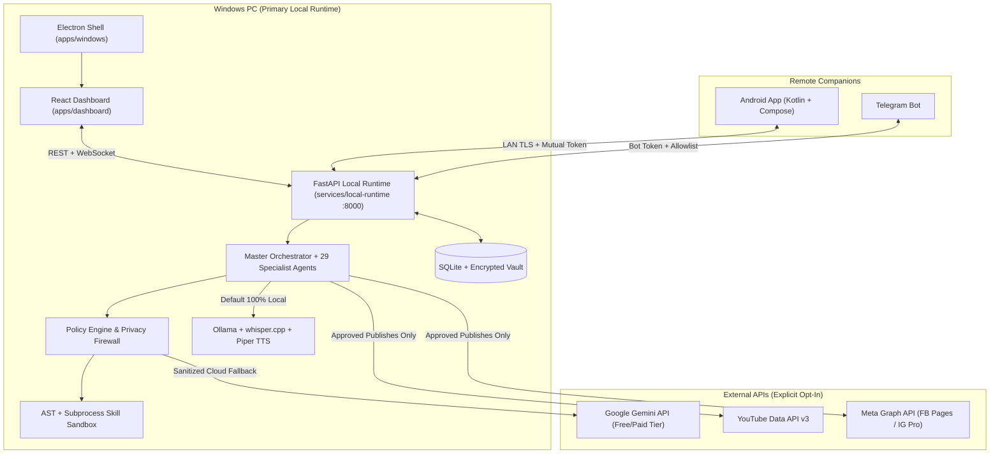

# Javo Agents — System Architecture

## 1. High-Level Overview

Javo Agents is a **local-first, privacy-preserving multi-agent operating system** for content creators and solo operators. The Windows PC acts as the primary local brain (running FastAPI, SQLite, APScheduler, Ollama, whisper.cpp, Piper TTS, and the Electron/React Dashboard), while the Android app and Telegram bot act as secure, authenticated remote companions.

---

## 2. Core Components & Monorepo Layout

| Directory | Purpose | Stack |
| :--- | :--- | :--- |
| `services/local-runtime` | FastAPI API, SQLAlchemy 2.0 SQLite DB, 29 agents, scheduler, AI router | Python 3.11+, FastAPI, Uvicorn |
| `apps/dashboard` | Desktop control center, 16-node visual workflow builder, setup wizard | React, TypeScript, Tailwind, React Flow |
| `apps/windows` | Electron wrapper, tray controls, single-instance lock, backend launcher | Electron, TypeScript, electron-builder |
| `apps/android` | Companion app for voice mode, approval inbox, offline drafts, pairing | Kotlin, Jetpack Compose, Room, Keystore |
| `apps/website` | Product landing site & documentation portal | Next.js, TypeScript, Tailwind |
| `packages/*` | Shared types, API client, 16-node workflow schema, policy engine, brand assets | TypeScript |
| `skills/` | Core skills, JSON manifest schema, AST + subprocess sandbox | Python 3.11+ |
| `models/` | Hardware-tiered Ollama / whisper.cpp / Piper manifests | JSON |

---

## 3. Architectural Decision Records (ADRs)

### ADR-001: Local-First Runtime with SQLite + WAL Mode
- **Decision**: Run all orchestration, persistence, and scheduling locally on the user's Windows PC using SQLite (`sqlite+aiosqlite`) rather than a mandatory cloud database.
- **Rationale**: Eliminates recurring server costs, preserves creator intellectual property on local disk, and enables offline drafting and scheduling.

### ADR-002: Supervised Autopilot & Human Approval Gates
- **Decision**: All external side effects (`publish`, `comment_reply`, `delete_content`, `install_skill`) default to `require_approval` in Supervised Autopilot mode unless explicitly whitelisted by policy.
- **Rationale**: Prevents accidental brand damage, spam flags, or unauthorized publishing while still automating research, drafting, tagging, and scheduling.

### ADR-003: Constrained AST + Subprocess Skill Sandbox
- **Decision**: Self-upgrading skills are executed in an isolated Python subprocess (`python -I`) after static AST validation and environment credential scrubbing.
- **Rationale**: Allows Javo Agents to add deterministic helpers without exposing `JAVO_SECRET_KEY`, API tokens, or unrestricted OS shell access.

### ADR-004: Zero-Cost Default AI Routing
- **Decision**: Route all AI prompts to local **Ollama** models (`qwen2.5:3b-instruct-q4_K_M` on 8 GB RAM) by default, with optional free-tier **Gemini** fallback gated by the Privacy Firewall and daily/monthly spend caps.
- **Rationale**: Guarantees $0 baseline operating cost and predictable latency on consumer Windows hardware.

### ADR-005: Official Social APIs Only
- **Decision**: Integrate exclusively with official YouTube Data API v3 and Meta Graph API (Facebook Pages & Instagram Professional), never headless browser scraping or credential password-stuffing.
- **Rationale**: Protects creator accounts from bans and ensures compliance with platform terms of service and Google Play policies.
